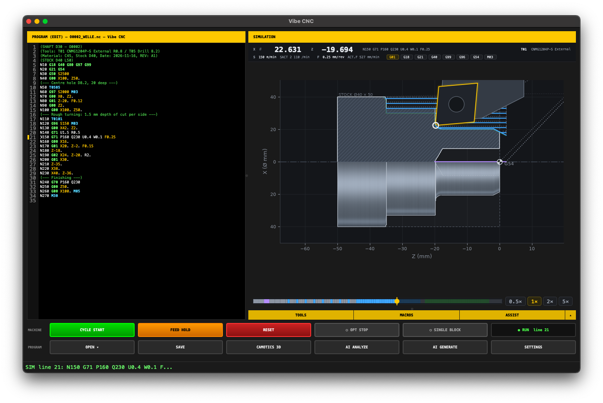

# Vibe CNC

A desktop simulator and editor for FANUC lathe programs (0i-TF, G-code
system A), with a rule-based checker and optional AI review and generation.

[](https://github.com/burnshall-ui/vibeCNC/actions/workflows/ci.yml)
[](https://www.python.org/)
[](LICENSE)

> [!WARNING]
> Vibe CNC simulates; it does not prove a program safe. The collision check,
> the lint rules and the AI review are heuristics, and a language model writes
> plausible G-code that can be wrong about your tools, offsets, chuck and
> stock. Before a program reaches a machine, read every line, check the tool
> table and work offsets on the control, dry-run it well clear of the part,
> and keep a hand on feed hold. The authors accept no liability for crashes,
> scrapped parts or injury.



## Features

- **Editor**: syntax highlighting, line numbers, find and replace,
  autocomplete, tool and macro libraries with their own editors.
- **Simulation**: the toolpath drawn to scale and played back block by block,
  with CYCLE START, FEED HOLD, SINGLE BLOCK and OPT STOP. The tool -- insert
  and holder at their real size, or the drill -- travels along each move,
  and the stock is cut as it goes, shown as a half section: hatched above the
  centre line, the turned part below it. Moves ahead are drawn faint, the
  move being made in yellow. Moves into the chuck are reported.
- **Position display and timeline**: above the simulation X and Z, the tool,
  spindle speed and feed (under G96 the speed at the tool's diameter) and the
  modal codes in force; below it the program as a band to jump around in,
  with playback at 0.5× to 5×.
- **Layout**: the program and the simulation side by side, each the full
  height of the window; the tool and macro libraries and the assist share a
  panel under the simulation that folds away (Ctrl+J).
- **Cycles**: G70–G76 and the one-block cycles G90, G92 and G94 are expanded
  into the moves they make. G32 threading and G41/G42 nose radius
  compensation are drawn as well.
- **Linter**: header, units and work offset; G50 before G96; spindle start;
  retract before M30; decimal points and value ranges in cycle words; the
  contour rules of G70–G73; protected M-codes. Every finding has a severity and
  a stable rule id, and most a suggested fix.
- **AI, optional**: reviews the program in the editor against the shop rules,
  or writes G-code from a request. A generated draft is linted and the
  findings are sent back for correction, up to three times. Works with Claude,
  Ollama or any OpenAI-compatible server.

Nothing the AI writes goes into the editor by itself. *Lint clean* means the
linter finds nothing it knows about, not that the program is right.

## Installation

Requires Python 3.11 or newer.

```bash
git clone https://github.com/burnshall-ui/vibeCNC.git
cd vibeCNC
pip install -r requirements.txt
python3 vibe_cnc.py
```

`run.sh` (macOS, Linux) and `run.bat` (Windows) create a virtual
environment, install the requirements and start the app. On Linux, PyQt6
needs the Qt system libraries listed in
[`.github/workflows/ci.yml`](.github/workflows/ci.yml).

On first start `config.example.yaml` is copied to `config.yaml`, which the
settings dialog edits.

## AI backends

Editor, simulation and linter work without AI; set `ai.offline: true` to run
without a backend. Otherwise `ai.mode` selects one:

| `ai.mode` | Backend | API key |
|---|---|---|
| `claude` | Anthropic API, default model `claude-sonnet-5-5` | `ANTHROPIC_API_KEY` |
| `ollama` | A local or networked Ollama server | none |
| `openai` | Any OpenAI Chat Completions server: OpenAI, OpenRouter, LM Studio, llama.cpp, vLLM | the variable named in `ai.openai.api_key_env`, if the server needs one |

**Settings → AI → Test connection** checks the address, the key and the model
without running the model, so it cannot see a credit balance. Setup and
pitfalls for each backend: [docs/ai-backends.md](docs/ai-backends.md).

Whatever is reviewed or generated is sent to that backend. Decide which
programs may leave the shop.

## Usage

1. Open a program (Ctrl+O) or write one.
2. **CYCLE START** (Space) runs the simulation, **FEED HOLD** (F) pauses it,
   Esc resets. A click on the timeline under the simulation jumps there.
3. Ctrl+L lints the program. **AI ANALYZE** lints it and asks the model for a
   review.
4. Describe what you need in the assist box and press **AI GENERATE**
   (Ctrl+Enter). Tick *Generate a piece of a program* when the result goes
   into an existing program: the header, spindle start, retract and M30 are
   then not checked.

| Key | Action |
|---|---|
| Space · F · Esc | Cycle start · feed hold · reset |
| Ctrl+O · Ctrl+S | Open · save |
| Ctrl+L | Lint only |
| Ctrl+J | Fold or open the tools, macros and assist panel |
| Right click on the simulation | Menu: half section on or off, fit the view |
| Double click on the simulation | Fit the view again |
| Ctrl+F · Ctrl+H | Find · find and replace |
| Ctrl+Space | Autocomplete: G- and M-codes, tools after `T`, macros after `M98 P`. ↑/↓ to choose, Enter or Tab to insert, Esc to close |
| Enter · Ctrl+Enter | In the assist box: analyse · generate |
| Ctrl++ · Ctrl+- | Larger · smaller text |
| F5 | Open the program in CAMotics (optional, 3D) |
| Ctrl+Shift+S | Save, lint and copy to the simulation share (`paths.sim_share`) |

## Configuration

[`config.example.yaml`](config.example.yaml) documents every setting. For a
machine, these matter most:

- `machine.chuck_z_limit` and `machine.chuck_diameter`: where the chuck is.
  Measure the diameter; while it is unset, every diameter behind the chuck
  face counts as a collision.
- `policies`: the header codes, units and work offset the linter expects, and
  the M-codes that must never be commented out.
- [`tools/tools.json`](tools/tools.json): the tool library. The simulation
  draws a tool from its ISO codes: the holder in `holder` (ISO 5608, e.g.
  `PCLNR2525`) and the insert at the start of `name` (ISO 1832, e.g.
  `CNMG1204...`); a drill from its `d_mm`. A tool without them is drawn as a
  ring. Nose radius compensation reads `insert_radius_mm` and
  `nose_direction`, the Fanuc tip number:

| Tip | Programmed point relative to the radius centre | Typical tool |
|---|---|---|
| 1 · 2 · 3 · 4 | −X+Z · −X−Z · +X−Z · +X+Z | 2 = OD turning, 3 = boring |
| 5 · 6 · 7 · 8 | −X · −Z · +X · +Z | facing and grooving |
| 0 · 9 | on the centre | probe, or no compensation wanted |

Fanuc prints this figure twice, mirrored in X for the two tool post
positions. The table above matches this shop's machine; if yours is the other
way round, mirror `NOSE_OFFSETS` in `vibe_cnc/tool_data.py` rather than
renumbering the tools. Without a `nose_direction` the simulation assumes 0 and
says so.

The shop rules sent with every review are in [`policies.md`](policies.md).

## The control model

What the simulator knows about the control is data, in
[`specs/fanuc_0i_tf/`](specs/fanuc_0i_tf): `dialect.toml` lists the G- and
M-codes of G-code system A, and one card per cycle G70–G76 gives its blocks,
words, units, where a decimal point is forbidden, value ranges and what the
simulator assumes about the cycle. The linter checks against the cards, the AI
is shown them, and autocomplete reads the dialect.

The cards were checked against the FANUC Series 0i-MODEL F operator's manual
for the lathe system (B-64604EN-1/01, section 4.2), and each assumption names
the section that supports it. None of it has been confirmed on a 0i-TF Plus
yet, so every card says `verified = false`. Known simplifications:

- G76 is drawn feeding straight in; the control feeds along one flank.
- The relief at the bottom of G74/G75 and the width of a grooving tool are
  not drawn.
- G73 spaces its passes evenly between the first and the last; the manual
  does not say how.
- The 45° escape after each G71/G72 pass is drawn as a rapid; the control
  makes it at cutting feed.
- Inch input (G20) is not supported.
- The material removed takes each tool's body from its tip number, and the
  clearance behind the tip from its holder and insert codes (5° for a CNMG
  in a 95° holder). Without the codes the body is a square shoulder behind
  the tip, so a move running down towards the chuck shows a gouge sooner
  than a real insert would cut one. Drills bore their `d_mm` with a 118°
  point. Grooving, parting and thread tools remove nothing (the table has
  no width), and neither do thread passes.
- The position display shows speeds and feeds as the control would command
  them, not as measured, and no cycle time: rapid rates are not known, and
  G70 runs at the feeds of its contour blocks, which are not tracked per
  move.

## Development

See [CONTRIBUTING.md](CONTRIBUTING.md) for the two test suites and the
conventions, and [docs/PLAN.md](docs/PLAN.md) for the architecture and what
comes next. [`evals/`](evals) measures how well a model reviews and generates
programs: [docs/evals.md](docs/evals.md).

```
vibe_cnc.py           main window
vibe_cnc/             parser, linter, specs, verifier, AI client, plotter, UI
specs/fanuc_0i_tf/    dialect and cycle cards (TOML)
tools/                tool and macro libraries (JSON)
evals/                model evaluations
tests/                unit tests; fixtures/reference.nc exercises every parser branch
policies.md           shop rules for the linter and the AI
```

## License

Apache License 2.0, see [LICENSE](LICENSE).
